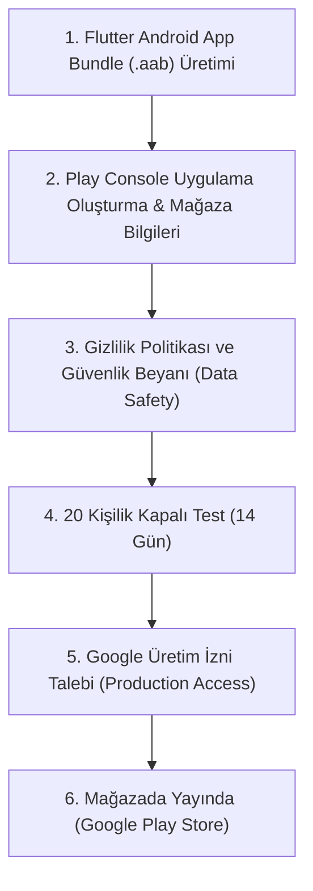

# 🚀 Arya Pet Hizmetleri — Google Play Store Yayınlama & Kabul Rehberi (2026 Güncel)

Bu rehber, **Arya Pet Hizmetleri** ve **Arya Pet Nakil** uygulamasının Google Play Console'a yüklenip sorunsuz onay alması için gereken tüm teknik, yasal ve içerik gereksinimlerini adım adım özetler.

---

## 1. Geliştirici Hesabı ve Zorunlu 20 Test Kullanıcısı Kuralı

> [!IMPORTANT]
> Google'ın 13 Kasım 2023 sonrası açılan tüm bireysel geliştirici hesapları için koyduğu en kritik kural: Uygulama açık yayına (Production) çıkmadan önce **en az 20 test kullanıcısı ile 14 gün boyunca aralıksız Kapalı Test (Closed Testing)** sürecinden geçmelidir.

1. **Google Play Console Hesabı:**
   - 25$ tek seferlik kayıt ücreti ile açılır.
   - D-U-N-S numarası (Kurumsal hesap açılacaksa) veya T.C. Kimlik / Pasaport doğrulaması yapılır.
2. **Kapalı Test (Closed Testing):**
   - 20 arkadaş, müşteri veya tester Gmail adresi Google Play Console'a eklenir.
   - Bu kişilerin uygulamayı indirip 14 gün boyunca cihazlarında tutmaları ve Google anketine kısa geri bildirim vermeleri gerekir.

---

## 2. Teknik Gereksinimler (Flutter / Android)

- **Target SDK:** En az `Android 14 (API Level 34)` veya üzeri hedeflenmelidir (`targetSdkVersion 34+`).
- **Paket Formatı:** `.apk` kabul edilmez; release için `.aab` (Android App Bundle) derlenmelidir:
  ```bash
  flutter build appbundle --release
  ```
- **Paket Adı (ApplicationId):** Benzersiz olmalıdır: Örn: `com.aryapethizmetleri.app`.
- **Keystore / İmzalama:** Play App Signing kullanılır, `.jks` dosyası güvenli saklanmalıdır.

---

## 3. Play Store Mağaza Varlıkları (Grafik & Tasarım)

Google Play Store paneline yüklenecek hazır görseller:
1. **Uygulama İkonu:** `512 x 512 px`, 32-bit PNG, şeffaf arkaplan içermeyen (Arya'nın negatif alanlı siyah/fildişi rozet logosu).
2. **Öne Çıkan Görsel (Feature Graphic):** `1024 x 500 px`, JPG veya 24-bit PNG.
3. **Ekran Görüntüleri (Screenshots):**
   - Telefon: En az 4 adet (Pet Nakil canlı rota, Kuaför randevu, Veteriner acil ambulans, S.A.H Sahiplendirme, Hayvan Ansiklopedisi).
   - En boy oranı: 16:9 veya 9:16 (Örn: `1080 x 2400 px`).

---

## 4. Google Politikaları ve Reddedilmeyi Önleme Kontrolleri

### A. Gizlilik Politikası (Privacy Policy) — ZORUNLU
- Play Store'a yüklenecek canlı bir URL gerekir (örn: `https://aryapethizmetleri.com/privacy-policy`).
- Kullanıcının konumu (canlı nakil rotası için) ve telefon numarası alındığı için açıkça belirtilmelidir:
  > *"Arya Pet Hizmetleri, pet nakil rotalarının hesaplanması ve sürücüyle eşleştirme amacıyla konum verilerini yalnızca işlem esnasında kullanır."*

### B. Arka Plan Konum İzni (Background Location) Uyarısı
- Uygulama sadece müşteri tarafı ise `ACCESS_FINE_LOCATION` yeterlidir; arka plan izni (`ACCESS_BACKGROUND_LOCATION`) **istenmemelidir** (Google gereksiz arka plan izinlerini doğrudan reddeder).
- Canlı takip, sürücünün gönderdiği WhatsApp canlı konum bağlantısı üzerinden web tabanlı çalıştığı için Google'ın ağır konum denetimlerinden muaf kalır!

### C. Kullanıcı Tarafından Oluşturulan İçerik (UGC) — S.A.H İlanları İçin
- S.A.H sekmesinde kullanıcılar ücretsiz sahiplendirme ilanı açabilmektedir.
- Google Play politikası gereği:
  1. İlanlar için bir **"Şikayet Et / Bildir" (Report)** butonu olmalıdır.
  2. Saldırgan veya sahte ilan veren kullanıcıyı **"Engelle" (Block)** fonksiyonu bulunmalıdır.
  3. İlanlar yayına girmeden önce admin panelinde **Editör Onayı** mekanizmasından geçmelidir.

### D. Canlı Test / Demo Giriş Bilgileri
- Google inceleme ekibi (Reviewers) uygulamayı açtığında SMS şifresi beklemeden test edebilmelidir.
- Uygulama Giriş Bilgileri (App Access) kısmına test hesabı yazılır:
  - Telefon: `0555 000 00 00`
  - SMS Kodu: `123456`

---

## 5. Yayınlama Süreç Takvimi


